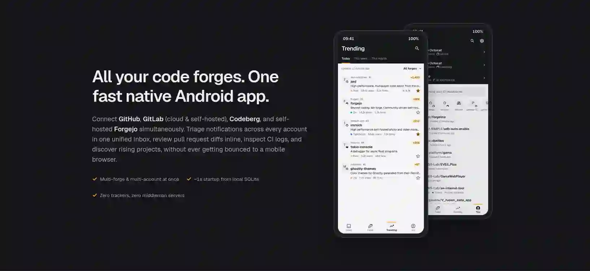

# Forgeline



**All your code forges, in one fast Android app.**

GitHub, GitLab, Codeberg and your own Forgejo server, side by side. See what needs you, follow what people are building, and find something new to love every day, without being sent off to a mobile web page.

[**Download the latest APK**](https://github.com/RoiArthurB/forgeline/releases/latest) · [Website](https://arthurbrugiere.fr/forgeline/) · [What's new](docs/release-notes)

## Why Forgeline?

- **Fast.** Every screen opens from what's already on your phone, then refreshes.
- **Native.** Kotlin and Jetpack Compose, with Forgeline's own soft, readable design.
- **Private.** No backend, no analytics, no trackers. The app talks directly to your forge.
- **Free.** Open source, under the GPL-3.0.

## A quick tour

Forgeline is built around three tabs:

- **Inbox**: what needs you comes first (review requests, mentions, assignments), then the rest, by repository. Swipe a thread away when you're done with it; there's always an Undo.
- **Feed**: what the people you follow and the repositories you watch are up to, plus new releases from the projects you starred.
- **Trending**: what's popular today, this week or this month, across forges. No account needed. It also gathers *first issues*, if you're looking for somewhere to contribute.

And everything you'd expect around them:

- Read a repository: its README, code, issues, pull requests, releases, CI runs and wiki.
- Review and merge pull requests: comment on a line, suggest a change, approve, merge.
- Open, comment on and triage issues.
- Search everywhere at once, and keep your favourite repositories in collections.
- Get notified, and keep an eye on your Inbox from a home-screen widget.
- Use it in English or French.

Curious about the details? Everything is listed in [docs/FEATURES.md](docs/FEATURES.md).

## Getting started

1. **Install** the APK from the [latest release](https://github.com/RoiArthurB/forgeline/releases/latest). Forgeline isn't on an app store yet ([here's why](docs/DISTRIBUTION.md)).
2. **Look around.** Trending works straight away, without an account.
3. **Sign in** to fill your Inbox and Feed. GitHub, gitlab.com and Codeberg sign you in through your browser. For your own server, a personal access token always works (a GitLab server can do browser sign-in too: [here's how](docs/GITLAB_OAUTH_APP.md)). You can be signed in to several accounts at once.

**Tip:** to open github.com, gitlab.com and codeberg.org links in Forgeline instead of the browser, go to *Settings → Apps → Forgeline → Open by default → Add links* and pick the forges.

## Building it yourself

You need the Android SDK (API 37). Gradle fetches its own JDK on the first run.

```sh
echo "sdk.dir=$HOME/Android/Sdk" > local.properties
./gradlew installRelease    # build the optimised app and install it on your phone
./gradlew testDebugUnitTest # run the tests
```

Signing in with a personal access token works out of the box. Browser sign-in needs each forge's app registered: see [GitHub](docs/GITHUB_OAUTH_APP.md), [Codeberg](docs/CODEBERG_OAUTH_APP.md) and [GitLab](docs/GITLAB_OAUTH_APP.md). [AGENTS.md](AGENTS.md) has the full workflow, and [RELEASING.md](docs/RELEASING.md) how a version goes out.

## Contributing

Found a bug, or have an idea? [Open an issue](https://github.com/RoiArthurB/forgeline/issues): it's the best way to make Forgeline better. Before writing code, [PRODUCT.md](PRODUCT.md) and [DESIGN.md](DESIGN.md) explain what the app aims for and how it looks.

## License

Forgeline is free software, licensed under the [GNU General Public License v3.0](LICENSE).
